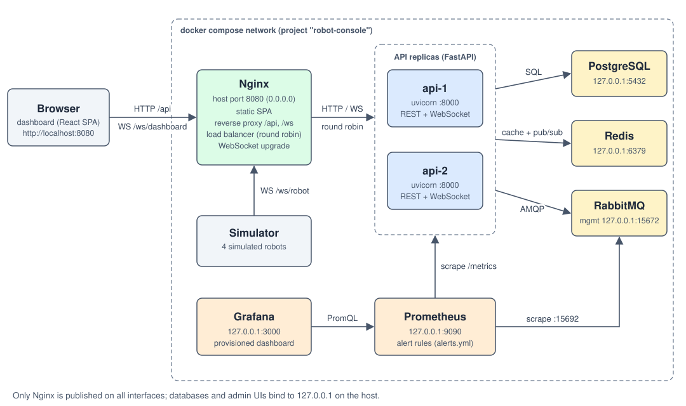
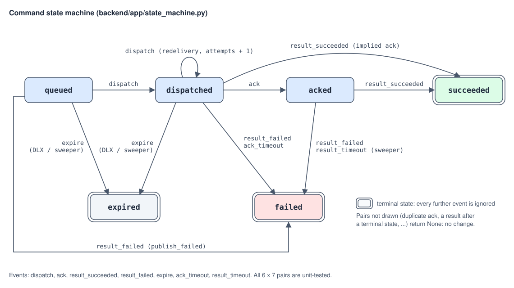

# 架构说明

本文说明 robot-console 的组件职责、三条主数据路径、命令状态机、故障处理方式，以及主要设计决策和它们的代价。接口、配置和表结构的精确契约见 [SPEC.md](../SPEC.md)。文中的文件路径都相对于仓库根目录。

目录：

1. [组件与职责](#components)
2. [三条主数据路径](#data-paths)
3. [命令状态机](#state-machine)
4. [故障处理](#failure-handling)
5. [可观测性](#observability)
6. [设计决策](#decisions)

<a id="components"></a>

## 1. 组件与职责



| 组件 | 职责 | 主要文件 |
|---|---|---|
| Nginx | 唯一对外入口（宿主机 8080 端口）。托管前端静态文件；把 `/api/`、`/ws/` 反向代理到两个 API 副本并轮询负载均衡；完成 WebSocket 协议升级；对 `/metrics` 返回 404，不对外暴露指标 | `frontend/nginx.conf`、`frontend/Dockerfile` |
| api-1 / api-2 | 同一份 FastAPI 代码的两个副本，只有 `REPLICA_ID` 不同。提供 REST 与 WebSocket 接口；为连在本副本的每台机器人消费命令队列；消费过期队列；订阅 Redis 并向本地看板推送；运行兜底清扫和遥测落库 | `backend/app/` |
| migrate | 一次性任务 `alembic upgrade head && python -m app.seed`，成功退出后两个 API 副本才启动 | `backend/alembic/`、`backend/app/seed.py` |
| PostgreSQL 16 | 持久数据：用户、机器人、命令、命令事件流水、遥测历史 | `backend/alembic/versions/0001_initial.py`、`backend/app/models.py` |
| Redis 7 | 机器人实时状态、在线租约、最近日志、看板票据；频道 `rc:events` 用于跨副本广播事件 | `backend/app/redis_bus.py` |
| RabbitMQ 3.13 | 每台机器人一个持久命令队列；死信交换机与过期队列 | `backend/app/mq.py` |
| simulator | 4 台模拟机器人：WebSocket 连接、运动与电量模型、命令执行与去重、随机断线 | `simulator/sim.py`、`simulator/robot_model.py` |
| Prometheus | 每 5 s 抓取两个 API 副本、RabbitMQ 和自身；按 `alerts.yml` 计算告警 | `ops/prometheus/` |
| Grafana | 从文件装载数据源与 "Robot Console" 看板 | `ops/grafana/` |

### 1.1 一个 API 副本内部

`backend/app/main.py` 的 lifespan（FastAPI 的启动/关闭钩子）在启动时连接 RabbitMQ（启动阶段会一直重试到 broker 可用），预先打开发布用的 channel，然后启动 5 个常驻任务：

| 任务名 | 作用 | 入口 |
|---|---|---|
| `redis-subscriber` | 订阅 `rc:events`，把收到的每条事件交给本副本的看板扇出 | `RedisBus.run_subscriber` |
| `redis-outbox` | 按顺序把发件箱里的 `command_update` 事件发布到 `rc:events` | `RedisBus.run_outbox` |
| `expired-consumer` | 竞争消费 `cmd.expired`，把过期命令标记为 `expired` | `CommandDispatcher.run_expired_consumer` |
| `command-sweeper` | 每 30 s 清扫一次卡住的命令 | `CommandSweeper.run` |
| `telemetry-flusher` | 每 `TELEMETRY_FLUSH_INTERVAL_S` 秒（默认 1 s）把遥测缓冲批量写入 PostgreSQL | `TelemetryWriter.run` |

此外，每条机器人连接各带两个任务：派发任务（消费这台机器人的命令队列）和状态写入任务（把遥测、日志、在线标记写进 Redis）。每条看板连接带一个发送任务。

一个 HTTP 请求由外到内经过的中间件：

1. `RequestIdMiddleware`：沿用合法的 `X-Request-ID` 或生成新的 UUID，存入 contextvar（随协程传递的上下文变量），响应头加上 `X-Request-ID` 和 `X-Replica`；
2. `AccessLogMiddleware`：每个请求一行 JSON 访问日志；
3. `MetricsMiddleware`：按路由模板记录 `rc_http_request_duration_seconds`；
4. `CORSMiddleware`：只为 Vite 开发服务器准备，经 Nginx 访问时是同源请求，用不到。

认证和角色检查不放在中间件里，而是作为 FastAPI 依赖项挂在各个接口上（`backend/app/deps.py`）：中间件在路由匹配之前执行，不知道某个接口需要什么角色。

### 1.2 数据模型

表结构由手写的迁移 `backend/alembic/versions/0001_initial.py` 定义：

| 表 | 要点 |
|---|---|
| `users` | 用户名唯一；`role` 只能是 `admin` 或 `viewer`；口令存 bcrypt 哈希 |
| `robots` | 主键是机器人 id（如 `robot-1`）；`token_hash` 是 token 的 sha256 十六进制摘要，不存明文 |
| `commands` | 主键是 UUID；`status`、`attempts`（每次投递加 1）、`error`、`dispatched_at` / `acked_at` / `finished_at`；唯一约束 `(robot_id, idempotency_key)`；索引 `(robot_id, created_at DESC)` |
| `command_events` | 每次成功的状态转移追加一行（`from_status`、`to_status`、`detail`、`replica`、`at`），按 `command_id` 建索引 |
| `telemetry` | 遥测历史，索引 `(robot_id, ts DESC)` |

### 1.3 Redis 键与频道

| 键 / 频道 | 类型 | 内容 | 谁写 |
|---|---|---|---|
| `robot:{id}:state` | HASH | 最新遥测的各字段，加上 `replica` 和 `last_seen`（服务端收到的时间） | 机器人所在副本的状态写入任务 |
| `robot:{id}:online` | STRING，`EX ROBOT_ONLINE_TTL_S`（默认 5 s） | 机器人当前连接所在的副本名。每条遥测都会续期，相当于一个租约（lease）：持有者不续期，它就自动过期 | 同上；断开时只在值仍是本副本名时删除 |
| `robot:{id}:logs` | LIST | 最近 200 条日志（`LPUSH` 后 `LTRIM 0 199`） | 同上 |
| `ws-ticket:{ticket}` | STRING，`EX 30` | 看板一次性票据，值为 `{sub, role, exp}` | `POST /api/ws-ticket` |
| `rc:events` | pub/sub 频道 | `telemetry`、`robot_status`、`command_update`、`log` 四种事件 | 所有副本 |

### 1.4 RabbitMQ 拓扑

- **机器人队列** `cmd.robot.{robot_id}`：持久队列，声明参数固定为 `{"x-message-ttl": COMMAND_TTL_MS, "x-dead-letter-exchange": "cmd.dlx"}`。发布端、消费端和每个副本都用完全相同的参数声明，否则 RabbitMQ 会以 `PRECONDITION_FAILED` 拒绝。
- **命令消息**：经默认交换机发布（routing key 就是队列名），持久化（`delivery_mode=2`），`message_id` 等于命令 id，消息体是 `{"command_id", "command", "params"}`。
- **死信交换机** `cmd.dlx`：fanout 类型、持久，绑定持久队列 `cmd.expired`。所有副本竞争消费 `cmd.expired`（prefetch 10），一条死信只会被其中一个副本拿到。

<a id="data-paths"></a>

## 2. 三条主数据路径

### 2.1 命令路径：下发 → 入库 → 入队 → 机器人 → ack → 结果 → 看板

以操作员给 `robot-1` 下发一条 `move_to` 为例。

**1. 浏览器发起请求。** "下发命令"面板（`frontend/src/components/CommandPanel.tsx`）每次点击都生成一个新的幂等键（Idempotency-Key，用来让服务端识别"同一次操作的重试"），调用 `POST /api/robots/robot-1/commands`。如果请求结果未知（网络错误、Nginx 返回 502/504），`frontend/src/api.ts` 的 `createCommand` 会用同一个键最多再重试 2 次；Nginx 自己不会重试已经发给某个副本的 POST，因为它无法判断那个副本是否已经执行。

**2. 校验。** 请求被 Nginx 分给任一副本。`backend/app/routers/commands.py` 依次检查：JWT 有效且角色为 `admin`（否则 401/403）、机器人存在（否则 404）、请求体符合 `CommandIn`（按 `type` 区分三种命令的联合类型，参数越界返回 422）。

**3. 入库（幂等）。** `commands_service.create_command`：

- 带了幂等键时先按 `(robot_id, idempotency_key)` 查一次，命中就直接返回已有命令（HTTP 200）；
- 否则 INSERT 一行 `status = queued`、`attempts = 0` 的命令。并发的重复请求会在唯一约束上冲突，冲突方捕获 `IntegrityError`、回滚、再查出胜出的那一行返回（HTTP 200）；
- 同一事务里追加一条事件流水（`None → queued`，detail `created`），然后提交；
- 提交后把一条 `command_update` 通知放进本副本的 Redis 发件箱（只入内存队列，不等待 Redis）。

先提交、后发布：消费者收到消息时，这一行必须已经能被查到。代价是进程恰好死在提交之后、发布之前时，库里有一条永远不会被派发的 `queued` 命令，由兜底清扫处理（见 [第 6.12 节](#decision-sweeper)）。

**4. 发布到 RabbitMQ。** `mq.MQ.publish_command` 在一个 5 s 的总预算内完成：取得开启了发布确认（publisher confirm：broker 把持久消息可靠接收后回一个确认）的 channel，幂等地声明 `cmd.robot.robot-1`，发布持久消息，等待确认。超时或失败时丢弃这个 channel，对命令应用事件 `result_failed`（detail `publish_failed`），接口返回 503。成功则返回 **202 Accepted** 和状态为 `queued` 的命令。

**5. 派发。** `robot-1` 的 WebSocket 连在哪个副本上，哪个副本就在消费它的队列（`CommandDispatcher.run_for_robot`）。这个消费者有自己专用的 channel，`prefetch_count=1`（broker 最多推给它 1 条未确认的消息）、手动 ack（消费者显式确认后 broker 才删除消息）。收到消息后，`_deliver`：

1. 从 `message_id` 取命令 id；
2. 做归属检查：读 `robot:robot-1:online`（最多等 0.5 s）。如果它指向另一个副本，说明本条连接已被机器人在别处的新连接取代，抛出 `ConnectionSupersededError`：不 ack、不改状态，channel 关闭后消息回到队列，旧连接以 4409 关闭（见 [第 6.8 节](#decision-ownership)）；
3. 应用 `dispatch` 事件：`queued → dispatched`，`attempts` 加 1，首次投递时写 `dispatched_at`。如果状态机返回 `None`（命令已是终态，例如已过期；或者机器人早已 ack 过这条命令），直接 ack 消息并跳过；如果数据库出错，`nack(requeue=True)` 后等 1 s；
4. 先在 `AckRegistry` 登记一个等待 ack 的 Future，再通过 WebSocket 发送 `{"type":"command","command_id",...,"attempt":1}`。先登记后发送，是因为机器人可能立刻回 ack；
5. 最多等 `ACK_TIMEOUT_S`（默认 10 s）。等到 ack 就确认 RabbitMQ 消息；超时则应用 `ack_timeout`（命令变为 `failed`），同样确认消息。消息被确认之后，broker 才会推送这台机器人的下一条命令。

**6. 机器人执行。** 模拟器（`simulator/sim.py` 的 `_on_command`）用一个容量 1000 的 LRU 集合记录处理过的 `command_id`。新命令和重复投递的命令都会立刻回 `ack`；只有新命令才真正执行。结果先进入机器人本地的发件队列，只有在当前连接收到服务端的 `hello` 之后才发送，断线期间产生的结果会在重连后补发。

**7. 服务端处理 ack 和结果。** 接收循环（`backend/app/routers/ws.py`）收到 `ack` 时，先唤醒第 5 步里等待的 Future，再应用 `ack` 事件（`dispatched → acked`，写 `acked_at`，并记录下发到 ack 的延迟）。收到 `result` 时应用 `result_succeeded` 或 `result_failed`（`acked → succeeded/failed`）。如果结果先于 ack 到达，`dispatched → succeeded/failed` 也是合法转移，结果本身证明机器人收到了命令，`acked_at` 会被补上。所有事件都带着机器人 id 应用：一台机器人不能确认别的机器人的命令。

**8. 通知看板。** 每次转移在事务提交之后执行 `finish_transition`：计数 `rc_command_transitions_total{to_status}`，记录 ack 延迟直方图，把 `command_update` 放进发件箱。发件箱任务把它发布到 `rc:events`，每个副本的订阅任务收到后推给本地所有看板。浏览器按"状态等级、`attempts`、`updated_at`"比较新旧版本（`frontend/src/pages/dashboardState.ts` 的 `isNewerCommand`），乱序到达的旧版本直接丢弃，界面上的状态不会倒退。

一次正常执行在 `command_events` 里留下 4 行，`GET /api/commands/{id}` 按自增 id 顺序返回。故障演练中记录到的一条命令，创建和派发发生在不同副本上：

```
from          to           replica   detail
(none)     -> queued       api-2     created
queued     -> dispatched   api-1     attempt 1
dispatched -> acked        api-1
acked      -> succeeded    api-1
```

命令在 `api-2` 上创建，因为 Nginx 把 POST 分给了它；派发、ack 和结果都发生在 `api-1`，因为 `robot-1` 的 WebSocket 连在那里。

### 2.2 遥测路径：机器人 → API → 最新状态缓存 / 降采样落库 / 扇出

**1. 上报。** 每台模拟机器人按 `TELEMETRY_HZ`（默认 5 Hz）推进运动模型，发送 `{"type":"telemetry","ts","x","y","theta","speed","battery","mode"}`。

**2. 校验。** 接收循环用 pydantic 按 `type` 字段解析机器人消息。非法 JSON 或不符合任何消息格式的内容只记一条警告并计数 `rc_ws_invalid_messages_total{kind="robot"}`，连接不受影响；电量必须在 0 到 100 之间，NaN 和无穷大被拒绝。

**3. 交给两个缓冲，立即返回。** `_on_telemetry` 只做内存操作：

- `TelemetryWriter.offer`：每台机器人每 0.5 s 最多接收一条（按服务端单调时钟判断，不信任机器人的时钟），缓冲上限 10,000 行；
- `RobotStateWriter.offer_telemetry`：覆盖这条连接的"最新样本"槽位，较旧的未写样本被新样本取代。

接收循环从不等待 Redis 或数据库，所以紧跟在遥测后面的 ack 和结果不会被一次慢调用拖住。

**4. 落库。** `TelemetryWriter.run` 每 `TELEMETRY_FLUSH_INTERVAL_S`（默认 1 s）把缓冲整体换出，用一条多行 INSERT 写入（每条语句最多 1000 行）并提交，计数 `rc_telemetry_rows_written_total`。写入失败记录日志并丢弃这一批，不影响进程；关闭时最后再写一次。

**5. 写最新状态并扇出。** `RobotStateWriter.run` 被唤醒后只写最新的那条样本，用一个 pipeline（一次往返发出多条命令）完成 `HSET robot:{id}:state`、`SET robot:{id}:online <副本名> EX 5` 和 `PUBLISH rc:events`（`telemetry` 事件）。Redis 慢的时候，中间的样本自然被跳过。日志走同一个任务：放进最多 100 条的队列，按顺序 `LPUSH` + `LTRIM 0 199` + `PUBLISH`，写成功才出队。写入失败时每 10 s 最多记一条警告（附带被压掉的次数），1 s 后重试。

**6. 读取。** `GET /api/robots` 的 `online` 来自 `robot:{id}:online` 是否存在，`state` 和 `last_seen` 来自 `robot:{id}:state`；`GET /api/robots/{id}/telemetry?seconds=120` 从 PostgreSQL 读取（命中索引 `(robot_id, ts DESC)`）；`GET /api/robots/{id}/logs` 读 Redis 列表。前端把每台机器人最近 120 s 的样本放在环形缓冲里（容量 600 = 5 Hz × 120 s），界面每 250 ms 检查一次有没有新数据再渲染，而不是每条遥测都触发一次渲染。

### 2.3 看板实时更新：跨副本的推送

**1. 换票。** 浏览器登录后持有 JWT。每次建立或重建 WebSocket 之前，`frontend/src/ws.ts` 先用 JWT（放在请求头里）调用 `POST /api/ws-ticket`，服务端生成 `secrets.token_urlsafe(32)` 票据，存为 Redis 键 `ws-ticket:{ticket}`（值为 `{sub, role, exp}`，`EX 30`）。票据存在 Redis 而不是某个副本的内存里，因为换票请求和随后的 WebSocket 握手可能被 Nginx 分到不同副本。

**2. 连接。** 浏览器打开 `/ws/dashboard?ticket=...`（协议 `ws:` 或 `wss:` 跟随页面）。服务端先 accept，再用 `GETDEL` 原子地取出并删除票据：票据不存在、已用过、已过期，或者 JWT 已过期，就以 4401 关闭；Redis 不可用时以 1011 关闭，前端退避重连而不是登出。先 accept 再用 4xxx 关闭码拒绝，是因为浏览器拿不到握手失败时的 HTTP 状态码，只能看到关闭码。

**3. 推送。** 任何副本产生的事件都发布到 `rc:events`：遥测、上线和日志来自机器人所在副本的状态写入任务，离线通知来自断开连接的副本，`command_update` 来自处理该转移的副本的发件箱。每个副本只有一个订阅任务，收到后调用 `DashboardHub.broadcast`，把事件 `put_nowait` 进每个本地看板自己的队列（容量 1000），再由每个看板专属的发送任务写到 WebSocket。队列满说明这个客户端跟不上，新事件被丢弃并计数 `rc_ws_dropped_total`，其他看板不受影响。

**4. 保活与过期。** 浏览器每 20 s 发 `{"type":"ping"}`，服务端回 `{"type":"pong"}`；超过 45 s 没有收到任何消息，前端判定连接已死并重连。服务端记住签发票据的 JWT 的过期时间，到点以 4401 `token expired` 关闭连接，所以连接寿命不会超过 JWT。

**5. 重连与校正。** 任何关闭（包括 4401）都按指数退避重连（1 s 起、30 s 封顶，带随机抖动），每次重连都换新票据；换票返回 401 才说明 JWT 真的失效，此时登出。pub/sub 不补发断线期间的事件，所以重连成功后前端用 REST 重新拉取机器人列表，以及当前选中机器人的遥测、命令和日志。

<a id="state-machine"></a>

## 3. 命令状态机



`backend/app/state_machine.py` 是一个纯函数 `next_status(current, event) -> str | None`，不做任何 IO。

- 6 个状态：`queued`、`dispatched`、`acked`，以及终态（terminal，进入后不再改变）`succeeded`、`failed`、`expired`。
- 7 种事件：`dispatch`、`ack`、`result_succeeded`、`result_failed`、`expire`、`ack_timeout`、`result_timeout`。

### 3.1 转移表

| 当前状态 | 事件 | 新状态 | 谁发出这个事件 | 说明 |
|---|---|---|---|---|
| `queued` | `dispatch` | `dispatched` | 机器人所在副本的队列消费者 | 首次投递：`attempts` 变为 1，写 `dispatched_at` |
| `dispatched` | `dispatch` | `dispatched` | 同上 | 重投：机器人断线后消息回到队列，重连后再次投递；`attempts` 再加 1 |
| `dispatched` | `ack` | `acked` | 机器人的 `ack` 消息 | 写 `acked_at`，记录下发到 ack 的延迟 |
| `dispatched` | `result_succeeded` | `succeeded` | 机器人的 `result` 消息 | 结果先于 ack 到达：结果隐含 ack，补写 `acked_at` |
| `dispatched` | `result_failed` | `failed` | 同上 | 同上 |
| `acked` | `result_succeeded` | `succeeded` | 机器人的 `result` 消息 | |
| `acked` | `result_failed` | `failed` | 同上 | `error` 为机器人给出的 detail，例如 `obstacle detected` |
| `queued` | `result_failed` | `failed` | 创建接口 | 发布到 RabbitMQ 失败，detail 与 `error` 为 `publish_failed`。没有这一行，命令会永远停在 `queued` |
| `queued` | `expire` | `expired` | 死信消费者或清扫器 | |
| `dispatched` | `expire` | `expired` | 死信消费者或清扫器 | 消息被放回队列后，机器人离线超过剩余 TTL |
| `dispatched` | `ack_timeout` | `failed` | 派发循环 | `ACK_TIMEOUT_S` 内没等到 ack；`error` 为 `ack_timeout` |
| `acked` | `result_timeout` | `failed` | 仅清扫器 | ack 之后超过 `RESULT_TIMEOUT_S` 没有结果；`error` 为 `result_timeout` |

其余 30 种组合全部返回 `None`，调用方什么都不做。值得注意的几类：

- 任何事件作用在终态上，例如成功之后才到的过期通知、过期之后才到的结果、`result_timeout` 之后才到的结果；
- `acked` 上的重复 `ack`；
- `acked` 上的 `expire` 和 `ack_timeout`：已 ack 的命令对应的 RabbitMQ 消息早已被确认删除，不会再产生死信；
- `queued` 和 `dispatched` 上的 `result_timeout`：结果超时只针对已 ack 的命令，未 ack 的由 `ack_timeout` 或过期处理。

`backend/tests/test_state_machine.py` 对全部 6 × 7 = 42 种组合逐一断言，另有针对重复 ack、乱序结果、终态不可改写的用例。

### 3.2 每次转移写什么

`commands_service._record_transition` 在同一行上更新：

- 总是更新 `status` 和 `updated_at`；
- `dispatch`：`attempts` 加 1；只在第一次投递时写 `dispatched_at`；
- 新状态为 `acked`，或从 `dispatched` 直接收到结果（隐含 ack）：写 `acked_at`；
- 新状态为终态：写 `finished_at`；
- `error`：`ack_timeout` / `result_timeout` 记录事件名；其他失败记录 detail（没有时为 `failed`）；过期记录 `expired`。

同时追加一行 `command_events`。默认配置下各场景的 detail：

| 场景 | 事件流水里的 detail |
|---|---|
| 创建 | `created` |
| 投递与重投 | `attempt 1`、`attempt 2`…… |
| ack 超时 | `no ack within 10s` |
| 死信过期 | `TTL elapsed while waiting in the queue (dead-lettered)` |
| 清扫器过期 | `swept: no update for over 90s while queued`（或 `while dispatched`） |
| 清扫器判结果超时 | `swept: no result within 300s after ack` |
| 发布失败 | `publish_failed` |
| 机器人报告失败 | 机器人给出的 detail，例如 `obstacle detected` |

### 3.3 怎样应用一个事件

`commands_service.apply_event(session, command_id, event, detail, replica=..., bus=..., robot_id=None)`：

1. `SELECT ... FOR UPDATE` 锁住命令行。`populate_existing` 保证拿到的是数据库里的最新值，而不是会话缓存里的旧对象；
2. 给了 `robot_id` 时，命令必须属于这台机器人，否则忽略，防止一台机器人确认别人的命令；
3. 调用 `transition_locked`：状态机返回 `None` 时回滚（立刻释放行锁）并返回；否则改字段、追加事件行；
4. 提交：命令行和事件行在同一个事务里，要么都生效，要么都没发生；
5. 提交成功后调用 `finish_transition`：计数 `rc_command_transitions_total`、记录 ack 延迟、把 `command_update` 放进发件箱。提交失败的转移从未发生，不会被计数，也不会推给看板。

清扫器使用同一个 `transition_locked`：先用 `SKIP LOCKED` 批量锁住多行，再逐行转移，最后整批提交。

为什么重复、迟到、乱序的事件不报错而是返回 `None`：在至少一次投递的链路里，"同一个事件来两次"和"事件晚到"是常态，不是错误。RabbitMQ 会重投，机器人会对重投的命令再回一次 ack，死信通知可能和机器人的结果同时到达，两个副本可能并发处理同一条命令的事件。状态机只回答"这个事件在当前状态下会不会带来新状态"，于是处理一次和处理多次的结果相同，终态一旦写入就不会被改写。

<a id="failure-handling"></a>

## 4. 故障处理

本节按故障类型说明系统的行为。对应的实测演练见 [FAILURE_DRILLS.md](FAILURE_DRILLS.md)。

### 4.1 一个 API 副本宕机或重启

- **新的 HTTP 请求**：Nginx 遇到连接错误或超时会把请求转给另一个副本（`proxy_next_upstream error timeout`，建连超时 `proxy_connect_timeout 2s`）；10 s 内失败 2 次的副本在接下来 10 s 内被跳过（`max_fails=2 fail_timeout=10s`）。
- **已经发给宕机副本的 POST**：Nginx 不会重试非幂等请求，结果未知时由前端用同一个幂等键重试（第 2.1 节第 1 步）。
- **机器人连接**：断开后模拟器按指数退避重连（等待上限从 1 s 起翻倍、封顶 15 s，实际等待在上限的一半到上限之间随机），经 Nginx 落到存活的副本。
- **在途命令**：宕机副本与 RabbitMQ 的连接断开，broker 把它未确认的消息放回队列，消息保留原来的过期时间点；机器人重连后由新副本重投，`attempt` 加 1，机器人按 `command_id` 去重后只回 ack、不重复执行。
- **在线标记**：宕机副本来不及删除 `robot:{id}:online`，它在 5 s 内过期；机器人的新连接建立时也会直接改写它。
- **看板**：连接断开后前端换新票据重连，落到存活的副本，重连后用 REST 校正数据。
- **告警**：Prometheus 抓取该副本失败，`up{job="api"} == 0` 持续 15 s 后触发 `ApiReplicaDown`。
- **正常停止**（`docker compose stop`）：uvicorn 先让 WebSocket 处理器退出，它们关闭各自的 channel，未确认的命令立刻回到队列；遥测缓冲在退出前最后写一次库。

### 4.2 RabbitMQ 宕机或重启

- **健康检查**：`/api/health` 的 `rabbitmq` 检查失败，返回 503 和 `"status": "degraded"`，容器被标记为 unhealthy。Nginx 不会因此摘掉副本，因为 `proxy_next_upstream` 不包含 `http_503`，只读接口照常可用。
- **新命令**：发布在 5 s 预算内失败，命令被标记为 `failed`（`publish_failed`），接口返回 503。用同一个幂等键重试会拿到这条已失败的命令（HTTP 200），重新下发需要新键。
- **恢复**：`connect_robust` 自动重连。每个消费循环发现自己的 channel 已关闭，就先暂停 1 s，再等连接恢复（`_open_channel` 开头的 `connection.ready()`），然后重新打开 channel 并重新声明拓扑（`CommandDispatcher._keep_consuming`）；发布 channel 在下一次发布时重新打开。
- **消息不丢**：命令是持久消息、队列是持久队列，RabbitMQ 数据保存在卷 `rabbitmq-data` 里，容器主机名固定为 `rabbitmq`（RabbitMQ 按节点名 `rabbit@<主机名>` 存数据，主机名变了就找不到原来的队列）。
- **没有幽灵消费者**：所有 channel 都是普通 channel，不会被 aio-pika 在重连后自动恢复，原因见[第 6.14 节](#decision-plain-channels)。

### 4.3 Redis 宕机

- **命令链路不受影响**：接收循环不等待 Redis；`command_update` 通知留在发件箱里，发布失败的那一条被丢弃，然后暂停 1 s；派发前的归属检查读不到在线标记时照常派发（fail open），每 10 s 最多记一条警告。
- **实时状态**：状态写入任务每次失败后 1 s 重试，期间新样本覆盖旧样本，待写日志最多保留 100 条。Redis 恢复后第一次写入就重建在线标记和最新状态。
- **看板**：订阅断开后按 1 s 起、5 s 封顶的退避重新订阅，Redis 恢复后几秒内重新收到推送；换票接口 `POST /api/ws-ticket` 返回 503，前端退避重试。
- **REST**：`GET /api/robots`、`GET /api/robots/{id}` 和 `GET /api/robots/{id}/logs` 返回 503（`live state unavailable (redis)`）；命令的创建与查询、遥测历史只依赖 PostgreSQL 和 RabbitMQ，不受影响。
- **健康检查**：`/api/health` 返回 503。

### 4.4 PostgreSQL 不可用

- **派发**：应用 `dispatch` 失败时 `nack(requeue=True)` 并暂停 1 s，消息稍后重新投递；死信消费者应用 `expire` 失败时同样处理。
- **机器人的 ack 和结果**：写库失败只记日志，这个事件就丢了，机器人不会重发。等待 ack 的 Future 在写库之前就已被唤醒，所以 RabbitMQ 消息仍会被确认。之后到达的结果仍可把 `dispatched` 直接推到终态；如果始终没有事件写进去，命令由清扫器收尾：停在 `dispatched` 的在 TTL + 60 s 后被标为 `expired`，停在 `acked` 的在 `RESULT_TIMEOUT_S` 后被标为 `failed`。这意味着机器人实际执行过的命令可能被记为 `failed` 或 `expired`（见 [LIMITATIONS.md](LIMITATIONS.md) 第 10 项）。
- **遥测**：这一批写入失败，被丢弃。
- **重连**：引擎设置了 `pool_pre_ping`，数据库重启后，连接池里失效的连接会在借出前被发现并替换。

### 4.5 进程崩溃在关键窗口里

- **命令已提交、尚未发布**：库里是 `queued`，队列里没有消息，不会被派发也不会产生死信。清扫器在 `updated_at` 超过 TTL + 60 s（默认 90 s）后把它标为 `expired`。
- **机器人 ack 之后崩溃、结果丢失**：命令停在 `acked`，对应的 RabbitMQ 消息已被确认删除。清扫器在 `acked_at` 超过 `RESULT_TIMEOUT_S`（默认 300 s）后把它标为 `failed`（`result_timeout`）。

### 4.6 连接层面的异常

- **机器人断线**：派发任务被取消、channel 关闭，未确认的消息回到队列并保留原过期时间点；重连后重投，`attempt` 加 1。离线超过剩余 TTL 的消息经死信变为 `expired`。
- **同一副本上的重复连接**：新连接登记时顶替旧连接。旧连接先停掉后台任务（关闭 channel，未确认消息回队列），再以 4409 `replaced` 关闭，然后新连接才开始消费，保证同一时刻只有一个消费者在给这台机器人派发。
- **跨副本的半开连接**：派发前的归属检查（第 2.1 节第 5 步）让旧连接让位；空闲的半开连接由 uvicorn 默认的 WebSocket 心跳清理（每 20 s 发一次 ping，20 s 内没有回应就关闭）。
- **断开时的离线广播**：只有"仍是当前连接"的那条连接注销时，才删除在线标记并广播离线。删除用一段 Lua 脚本在 Redis 里原子地"比较后删除"：值仍是本副本名才删，避免删掉机器人在另一个副本上刚写入的标记。
- **慢看板**：发送队列满了就丢弃新事件，计入 `rc_ws_dropped_total`，只影响这一个客户端。
- **非法消息**：JSON 或格式校验失败只忽略这一条消息并计数，连接不受影响；二进制帧按 UTF-8 解码后同样走校验。

<a id="observability"></a>

## 5. 可观测性

### 5.1 指标

指标定义在 `backend/app/metrics.py`，每个副本在 `/metrics` 暴露（不经过 Nginx，Nginx 对 `/metrics` 返回 404）：

| 指标 | 类型 | 标签 | 含义 |
|---|---|---|---|
| `rc_http_request_duration_seconds` | Histogram | `method`、`route`、`status` | HTTP 请求耗时；`route` 是路由模板，没匹配到路由的请求记为 `unmatched` |
| `rc_ws_connections` | Gauge | `kind`（`robot` / `dashboard`） | 本副本当前的 WebSocket 连接数 |
| `rc_telemetry_messages_total` | Counter | | 收到的遥测消息数 |
| `rc_ws_invalid_messages_total` | Counter | `kind` | 因校验失败被忽略的 WebSocket 消息数 |
| `rc_ws_dropped_total` | Counter | | 因看板发送队列已满而丢弃的事件数 |
| `rc_command_transitions_total` | Counter | `to_status` | 命令状态转移次数，包括创建时的 `queued` |
| `rc_command_ack_latency_seconds` | Histogram | | 从最近一次下发到机器人 ack 的耗时，桶从 0.005 s 到 10 s |
| `rc_telemetry_rows_written_total` | Counter | | 写入 PostgreSQL 的遥测行数 |

几个刻意的选择：

- **路由模板而不是原始路径**：`/api/robots/{robot_id}` 只是一个标签值，`/api/robots/robot-1` 则会让每个机器人 id、每个命令 UUID 都产生一组新的时间序列（标签基数爆炸）。中间件在内层应用返回后从 ASGI scope 里读出匹配到的路由（`middleware._route_label`）。
- **没有副本标签**：Prometheus 按抓取目标自动加上 `instance` 标签，再加一个副本标签只会重复。
- **预先创建已知标签组合**（`init_label_sets`）：带标签的指标在第一次使用前不会出现在输出里。如果从没有机器人连上，`rc_ws_connections{kind="robot"}` 这条序列不存在，`sum(...) < 1` 的结果是空而不是 0，告警永远不会触发。
- **ack 延迟从最近一次下发算起**：重投时用的是最新一次下发的时间（记在本副本内存里），机器人离线的那段时间不计入。

### 5.2 抓取与告警

`ops/prometheus/prometheus.yml`：抓取间隔 5 s（超时 4 s），规则每 5 s 计算一次。三个抓取任务：`api`（`api-1:8000`、`api-2:8000`）、`rabbitmq`（`rabbitmq:15692` 的 `/metrics/per-object`，按队列拆分的指标，看板据此画出每个机器人队列的积压）和 `prometheus`（自身）。

为什么直接抓两个副本而不是抓 Nginx 后面的入口：Nginx 会把请求轮流分给两个副本，同一条序列一会儿是 api-1 的计数、一会儿是 api-2 的，`rate()` 算出来没有意义；分开抓才有 `instance` 标签，才能看出是哪个副本慢或挂了。

`ops/prometheus/alerts.yml`（规则组 `robot-console`）：

| 告警 | 表达式 | 持续 | 级别 | 含义 |
|---|---|---|---|---|
| `ApiReplicaDown` | `up{job="api"} == 0` | 15s | critical | 某个副本连续 15 s 抓取失败 |
| `NoRobotsConnected` | `sum(rc_ws_connections{kind="robot"}) < 1` | 30s | warning | 所有副本上都没有机器人连接 |
| `CommandAckSlow` | `histogram_quantile(0.95, sum by (le) (rate(rc_command_ack_latency_seconds_bucket[1m]))) > 2` | 1m | warning | 下发到 ack 的 p95 延迟超过 2 s |
| `CommandsExpiring` | `increase(rc_command_transitions_total{to_status="expired"}[5m]) > 0` | 无 | warning | 最近 5 分钟有命令过期，通常意味着目标机器人长时间离线 |

`CommandAckSlow` 先把两个副本的直方图桶按 `le` 相加再算分位数：分位数不能各自算完再平均。两个副本都挂掉时 `rc_ws_connections` 根本不存在，`NoRobotsConnected` 不会触发，这种情况由 `ApiReplicaDown` 负责。项目没有接 Alertmanager，告警状态在 Prometheus 的 `/alerts` 页面查看。

### 5.3 Grafana

数据源（uid `prometheus`）和看板 "Robot Console"（uid `robot-console`）都由 `ops/grafana/provisioning/` 下的文件声明，删卷重建后自动恢复；看板不允许在界面上保存修改，以仓库里的 JSON 为准。看板包含 8 个面板：在线机器人数、在线看板数、存活的 API 副本数（3 个统计值），按副本的遥测消息速率，按路由的 HTTP p95 延迟，按目标状态的命令转移速率，命令 ack 延迟 p95，以及 RabbitMQ 各队列待投递的消息数。匿名访问为 Viewer 角色。

### 5.4 日志与请求追踪

- 后端所有日志（包括 uvicorn 和第三方库）都是一行一个 JSON 对象，字段包括 `ts`、`level`、`logger`、`msg`、`replica`，HTTP 请求内还有 `request_id`，以及调用方附带的业务字段（如 `robot_id`、`command_id`）。
- 每个 HTTP 请求一行访问日志（`method`、`path`、`status`、`ms`）；`/api/health` 和 `/metrics` 记为 DEBUG，避免淹没业务日志。
- Nginx 为每个请求沿用或生成 `X-Request-ID` 并传给后端，后端在响应里回显；同一个请求在 Nginx 访问日志（`req_id=`）和 API 日志（`request_id`）里能对上。
- 同一类故障反复发生时（例如 Redis 宕机期间每条写入都失败），警告每 10 s 最多记一条，`suppressed` 字段给出这期间被压掉的条数（`backend/app/log_throttle.py`）。
- 日志消息里出现的 `token=...` 会被打码成 `token=***`，作为凭证误入 URL 时的最后一道防线；一次性票据不打码，它很快失效，保留它方便排查。

<a id="decisions"></a>

## 6. 设计决策

每条决策按同一格式记录：决策是什么、考虑过的备选方案、为什么这样选、付出的代价。

<a id="decision-broker"></a>

### 6.1 命令消息走 RabbitMQ

**决策**：命令经 RabbitMQ 投递：每台机器人一个持久队列，发布确认加手动 ack（`backend/app/mq.py`、`backend/app/commands_service.py` 的 `CommandDispatcher`）。

**备选方案**：Redis Streams（消费者组 + `XACK`）；Kafka；由 API 直接轮询数据库里的待发命令。

**为什么这样选**：命令链路需要的能力，在 RabbitMQ 里都是 broker 自带的语义：按条手动确认，消费者的 channel 关闭时未确认消息自动回到队列（`requeue`），消息在队列里超时后转投死信交换机（`x-message-ttl` + `x-dead-letter-exchange`），按消费者限制在途消息数（`prefetch_count`）。Redis Streams 没有消息过期和死信，未确认的消息要靠 `XPENDING` / `XCLAIM` 自己扫描认领。Kafka 的消费者组按分区提交偏移量，不能单独确认或单独过期某一条消息，"每台机器人一个队列"会变成"每台机器人一个分区或主题"；它为高吞吐和回放而设计，而这里的消息是人工下发的命令，量很小。轮询数据库则要自己实现投递、确认、超时和并发控制。

**代价**：多运维一个有状态组件（Erlang 节点，需要固定主机名和持久卷）；推模式下消费端 channel 的生命周期要自己管理（[第 6.14 节](#decision-plain-channels)）；本项目是单节点，没有高可用。

<a id="decision-queue-per-robot"></a>

### 6.2 每台机器人一个队列

**决策**：每台机器人一个持久队列 `cmd.robot.{robot_id}`。它的消费者只在机器人在线时存在：机器人连到哪个副本，那个副本就为它开一个专用 channel（`prefetch_count=1`）消费，连接断开时关闭（`MQ.open_robot_queue`、`CommandDispatcher.run_for_robot`）。

**备选方案**：所有命令进一个共享队列，由各副本消费后再路由到机器人；或每个副本一个队列，发布方先查机器人连在哪个副本。

**为什么这样选**：

- **路由交给 broker**：共享队列里的消息可能被一个"机器人不在本副本"的副本拿到，它只能转发（需要副本间通信）或拒收重投（空转）。按机器人分队列后，"谁持有这台机器人的连接，谁就消费它的队列"，不需要任何路由表；"每个副本一个队列"则要求发布方知道机器人此刻连在哪里，而这个信息在重连时会变。
- **顺序与流控**：每台机器人只有一个消费者且 `prefetch_count=1`，前一条命令被机器人 ack（或判定 ack 超时）之前，broker 不会推下一条，同一台机器人的命令按发布顺序逐条下发。一台慢机器人不会阻塞其他机器人。这保证的是下发顺序，不是执行互斥：机器人可以在上一条 `move_to` 还没走完时收到下一条命令（模拟器里新的 `move_to` 会取代旧的，旧的以失败结束）。
- **离线语义**：机器人离线时它的队列没有消费者，消息原地等待，超时后转入死信。共享队列里无法表达"这条消息在等某台机器人上线"。
- **故障隔离**：一台机器人断线只关闭它自己的 channel，只有它的未确认消息被放回队列。

**代价**：队列数随机器人数线性增长，每个队列在 broker 上都有内存和元数据开销，监控指标也随之增加；消费者随连接频繁创建和销毁；队列一经创建就一直保留，本项目没有清理下线机器人队列的逻辑。规模扩大后的考虑见 [LIMITATIONS.md](LIMITATIONS.md)。

<a id="decision-expiry"></a>

### 6.3 过期用消息 TTL + 死信交换机

**决策**：过期交给 RabbitMQ：机器人队列声明 `x-message-ttl = COMMAND_TTL_MS`（默认 30,000 ms，队列里每条消息都在入队 30 s 后过期）和 `x-dead-letter-exchange = cmd.dlx`。过期消息经 fanout 交换机 `cmd.dlx` 进入 `cmd.expired`，所有副本竞争消费，按 `message_id` 找到命令并应用 `expire`（`CommandDispatcher._handle_expired`）。

**备选方案**：定时扫描数据库，把创建超过 30 s 仍在 `queued` 的命令标为过期；在每条消息上单独设置 `expiration` 属性（按消息设置 TTL）。

**为什么这样选**：

- **只有 broker 知道消息是否还在等待**：数据库只能看到状态，看不到消息。已投递但未确认的消息、断线后回到队列的消息，在库里都只是 `dispatched`；轮询要么误判，要么得自己重建 broker 的状态。死信恰好在"消息在队列里等满 TTL 仍没被取走"的那一刻产生。
- **不和投递竞争**：过期发生在 broker 内部，一条消息要么被投递，要么过期，不会两者都发生。
- **没有扫描负载**，也不需要额外的调度器。
- **用队列级 TTL 而不是按消息设置**：RabbitMQ 只在消息到达队头时才检查并丢弃按消息设置了过期时间的消息，一条长 TTL 的消息会挡住后面已经过期的消息；队列级 TTL 下所有消息的过期时间与入队顺序一致，队头总是最早过期的那条。

**代价**：

- 只覆盖"消息在队列里"这一段：已投递、未确认的消息不受 TTL 约束，直到被放回队列（放回后保留原来的过期时间点）；已 ack 的命令由 `ack_timeout` / `result_timeout` 处理。
- 消息根本没进队列（进程死在提交之后、发布之前）就不会有死信，需要清扫器兜底（[第 6.12 节](#decision-sweeper)）。
- TTL 和死信交换机写在队列参数里，修改 `COMMAND_TTL_MS` 必须删除并重建已有队列，否则声明会因参数不一致被拒绝（`PRECONDITION_FAILED`）。

<a id="decision-delivery-semantics"></a>

### 6.4 至少一次投递 + 幂等处理

**决策**：整条命令链路按"至少一次"（at-least-once：消息可能重复，但不会丢）设计，每一环都容忍重复：机器人按 `command_id` 去重（模拟器里是容量 1000 的 LRU 集合），服务端用状态机吸收重复和乱序的事件，创建接口用幂等键去重。

**备选方案**：追求"恰好一次"（exactly-once）投递，例如数据库与 broker 之间做分布式事务、在 broker 端去重；或者"至多一次"（at-most-once：先确认再执行，丢了就丢了）。

**为什么这样选**：跨越网络边界时，服务端无法区分"机器人没收到命令"和"机器人收到了，但 ack 在路上丢了"，只能选择重发（可能重复）或不重发（可能丢失）。对命令来说丢失更糟，所以选择重发，再在接收端让重复变得无害：重复投递只补一次 ack、不再执行，效果上等于"恰好执行一次"。服务端的状态机让重复和乱序的事件成为空操作，事件流水也不会自相矛盾。

**代价**：

- 去重责任落在机器人一侧：真实机器人必须在足够长的时间窗口内记住执行过的命令 id，最好持久化。模拟器的去重集合只在内存里，进程重启后会忘记。
- `attempts` 和事件流水会如实记录重投（`dispatched → dispatched`），读数据的人需要理解这一点。
- 模拟器断线期间产生的结果只在内存里排队，进程重启会丢失，这类命令最终由 `result_timeout` 收尾。

<a id="decision-row-lock"></a>

### 6.5 状态转移用 SELECT ... FOR UPDATE

**决策**：`apply_event` 在一个事务里 `SELECT ... FOR UPDATE` 锁住命令行，然后"读状态 → 问状态机 → 写新状态和事件流水 → 提交"（`commands_service.apply_event`、`transition_locked`）。

**备选方案**：乐观锁：给 `commands` 加版本号列，`UPDATE ... WHERE id = ? AND version = ?`，影响 0 行时重读重试；或者把转移表写成带 `WHERE status IN (...)` 条件的 UPDATE 语句。

**为什么这样选**：

- 同一条命令的事件真实存在并发：副本 A 在派发，副本 B 的死信消费者在过期，机器人的结果又从另一条连接到达。行锁让这些处理按行串行：后到的事务在锁上等待，前一个提交后，PostgreSQL 在 READ COMMITTED 隔离级别下把已提交的最新版本返回给它，它基于真实的当前状态问状态机（例如在 `expired` 上的 `dispatch` 得到 `None`）。
- 冲突只发生在"同一行上的少数几个事件"之间，持锁时间只是一次主键查询和两次写入，等待成本很低；乐观锁在冲突时要重读重试，代码路径更多。
- 状态机保持纯函数，转移规则只在 Python 里维护一处，不需要翻译成 SQL 条件。

**代价**：持有行锁期间不能做慢操作。代码在提交之后才发通知、记指标；派发时先提交 `dispatch` 再通过 WebSocket 发送，而不是在事务里发送。锁等待会占用数据库连接。将来如果一个事务要锁多行，需要固定加锁顺序以避免死锁。清扫器为此使用 `SKIP LOCKED`，从不等待正常路径持有的锁。

<a id="decision-idempotency"></a>

### 6.6 幂等键由唯一约束兜底

**决策**：幂等键的正确性由唯一约束 `uq_commands_robot_id_idempotency_key (robot_id, idempotency_key)` 保证。代码先按键查一次（快速路径），INSERT 冲突时捕获 `IntegrityError`、回滚，再查出已有的那条返回（`commands_service.create_command`）。

**备选方案**：只做"先查后插"；用 Redis `SET NX` 记录幂等键；在副本内存里记录。

**为什么这样选**：先查后插有竞态，两个并发请求可能同时查到"没有"，然后都插入。唯一约束把"是否重复"交给数据库在插入的那一刻原子判断，后到的 INSERT 会等先到的事务结束后报冲突。键和命令在同一张表、同一个事务里，不存在"键记下了但命令没建成"的中间状态；Redis 或内存方案要处理两者不一致，内存方案还无法在副本之间共享。PostgreSQL 的唯一约束里 NULL 互不相等，所以不带键的命令永远不会互相冲突。

**代价**：

- 键没有过期时间，会一直占用唯一索引；同一个键永远返回同一条命令，包括已经失败的命令（`publish_failed` 之后要用新键重新下发）。
- 键的作用域是"每台机器人"，不同机器人可以用同一个键。
- 服务端不比对请求体：同一个键配上不同的参数，返回的是第一次创建的命令，不会报错。

<a id="decision-fanout"></a>

### 6.7 跨副本推送用 Redis pub/sub 扇出

**决策**：所有副本把看板事件发布到 Redis 频道 `rc:events`；每个副本只有一条订阅连接，收到后在进程内扇出（fan-out，一条消息复制给多个接收者）给本地看板，每个看板一个容量 1000 的队列和一个专属发送任务（`backend/app/redis_bus.py`、`backend/app/ws_hub.py`）。

**备选方案**：会话粘滞（sticky session，例如按客户端 IP 哈希把同一浏览器固定到同一副本）；副本之间直接互相推送；每个看板一条 Redis 订阅；用 Redis Streams 或 RabbitMQ 的 fanout 交换机广播。

**为什么这样选**：

- 粘滞只能把"同一个浏览器"固定到同一个副本，解决不了"机器人连在 api-1、看板连在 api-2"：事件产生在机器人所在的副本，必须有跨副本的通道。pub/sub 让副本之间不需要知道彼此。
- 每个副本一条订阅而不是每个看板一条，Redis 的连接数和发送量与看板数量无关。
- 有界队列加独立发送任务是背压（backpressure）措施：订阅循环只做不阻塞的 `put_nowait`，一个网络很慢的看板不会拖住订阅循环；否则 Redis 端为这条订阅积压的数据超过 `client-output-buffer-limit` 后，Redis 会主动断开订阅连接，所有看板一起失去推送。
- 看板需要的是"最新状态"，pub/sub 没有持久化开销，延迟低；需要可靠投递的命令本身走 RabbitMQ。

**代价**：pub/sub 是"发后即忘"（at-most-once）：订阅断开期间的事件直接丢失，Redis 不会补发。因此看板只是尽力而为的实时视图，正确性由其他机制保证：重连后用 REST 重新拉取，界面上的命令状态按版本只进不退。跨副本的事件顺序无法保证，由前端按"状态等级、`attempts`、`updated_at`"丢弃旧版本。慢看板会丢事件，直到下一次刷新或重连。

<a id="decision-ownership"></a>

### 6.8 派发前检查机器人归属

**决策**：每条命令派发之前读 `robot:{id}:online`（最多等 0.5 s）。值是另一个副本时，本条连接已被取代：停止消费、不改状态，channel 关闭后消息回到队列，WebSocket 以 4409 `replaced by a newer connection` 关闭（`CommandDispatcher._owned_by_another_replica`、`routers/ws.py` 的 `_run_dispatcher`）。在线标记在连接建立后、派发开始之前写入（`RobotStateWriter.announce_online`，最多等 2 s），之后随每条遥测续期。

**备选方案**：只靠单副本内的 `RobotRegistry`（同一副本上新连接顶替旧连接）；依赖 TCP keepalive 或 WebSocket ping 尽快发现死连接；用 Redis 分布式锁持有"机器人所有权"。

**为什么这样选**：机器人断线后重连到另一个副本时，旧副本上的连接可能是半开的（half-open：对方已经消失，本端 TCP 还没察觉）。旧连接的消费者仍挂在同一个队列上，RabbitMQ 会在两个消费者之间轮流投递，一部分命令会被发进死连接，白等 10 s 后以 `ack_timeout` 失败。`RobotRegistry` 只能处理同一副本内的重复连接；按 uvicorn 默认的 WebSocket 心跳（每 20 s 一次 ping，20 s 超时），判定一条死连接要 20 到 40 s，期间的命令照样会丢进死连接。在线标记由最新的连接写入，并由它的遥测不断续期；半开的旧连接收不到遥测，也就不会改写它，所以标记指向哪个副本，机器人就真正连在哪里。检查发生在应用 `dispatch` 之前，被让出的命令 `attempts` 不变，不算一次失败。分布式锁要处理锁的续期和释放，而在线标记本身就是一个由遥测续期的租约，不需要另一套机制。

**代价**：每条命令多一次 Redis 读取；Redis 故障或超时时退化为没有这层保护（fail open），宁可偶尔把命令发进死连接，也不因为 Redis 挂了就停发命令；标记最多有 `ROBOT_ONLINE_TTL_S`（5 s）的滞后。这个检查只在"确实有命令要派发"时发现过时的连接；空闲的半开连接由 uvicorn 的 WebSocket 心跳清理。

<a id="decision-ws-ticket"></a>

### 6.9 看板 WebSocket 用一次性票据

**决策**：浏览器先调用 `POST /api/ws-ticket`（JWT 在 `Authorization` 头里）换一张 `secrets.token_urlsafe(32)` 生成的票据，再连接 `/ws/dashboard?ticket=...`。服务端用 Redis `GETDEL` 兑换（只能用一次），票据 30 s 后自动过期；服务端记住签发票据的 JWT 的过期时间，到点以 4401 关闭连接（`routers/auth.py` 的 `issue_ws_ticket`、`routers/ws.py` 的 `dashboard_socket`、`security.py`）。机器人不是浏览器，可以自由设置握手请求头，所以直接在握手里带 `Authorization: Bearer <token>`，查询参数里的 `token` 一律不接受。

**备选方案**：把 JWT 放进查询参数 `?token=`；用 `Sec-WebSocket-Protocol`（子协议）请求头携带 JWT；用 Cookie 认证；连接建立后用第一条消息认证。

**为什么这样选**：浏览器的 WebSocket API 不能自定义请求头，凭证只能放在 URL、子协议或 Cookie 里。URL 会被写进日志：Nginx 的 error log 在上游失败时会写出完整的请求行（包括查询参数），这不受 `log_format` 控制。JWT 有效期 8 小时（`JWT_EXPIRE_MINUTES=480`）且能调用全部接口，写进日志就等于泄露。票据只能用一次、30 s 后作废，最多换来一条只读的事件流，出现在日志里也无害。其他方案各有问题：子协议头本来用于协商协议，借来传凭证还要求服务端回显协议名；Cookie 方案要防范跨站 WebSocket 劫持（WebSocket 握手不受同源策略保护，需要校验 `Origin`）；首条消息认证会让未认证的连接一直占着资源直到超时。

**代价**：每次连接（包括每次重连）多一次 HTTP 往返和一次 Redis 写入；看板建立连接依赖 Redis，Redis 不可用时换票返回 503，兑换失败时以 1011 关闭；已建立的连接只受 JWT 过期时间约束，而本项目没有提前吊销 JWT 的机制。

<a id="decision-auth"></a>

### 6.10 无状态 JWT + 两种角色

**决策**：登录后签发 HS256 JWT，载荷 `{sub, role, exp}`，默认有效 480 分钟。每个需要登录的接口通过依赖项 `get_current_user` 校验，下发命令的接口再经 `require_admin` 检查角色（401 表示"你是谁"没有通过，403 表示"知道你是谁，但没有权限"）。口令用 bcrypt，在线程池里计算以免阻塞事件循环；用户名不存在时也用一个固定的哈希跑一遍校验，让"用户不存在"和"密码错误"耗时相同。机器人 token 只存 sha256 摘要，用常数时间比较（`security.py`、`deps.py`、`routers/auth.py`）。

**备选方案**：服务端会话（session id 存在 Redis 或数据库）；接入外部身份提供方（OAuth 2.0 / OIDC）；机器人 token 也用 bcrypt 存储。

**为什么这样选**：两个副本不需要共享会话存储，任何副本都能独立校验 JWT。只有两种角色，权限差异只在"能否下发命令"，用依赖项按接口声明最直接，而且会出现在 OpenAPI 文档里。人的口令熵低、可被字典枚举，需要故意很慢、自带随机盐的 bcrypt；机器人 token 应当是机器生成的高熵随机串，sha256 已经足够，而机器人重连频繁，每次握手都跑 bcrypt 会白白消耗 CPU。

**代价**：JWT 在过期前无法吊销，没有黑名单，登出只是前端删除 token；HS256 是对称密钥，所有副本共享 `JWT_SECRET`，泄露后可以伪造任意角色的 token（API 启动时对默认密钥打警告）；前端把 JWT 存在 localStorage，页面上的任何脚本都能读到；没有刷新令牌，过期后需要重新登录。见 [LIMITATIONS.md](LIMITATIONS.md)。

<a id="decision-nginx-resolve"></a>

### 6.11 Nginx 动态解析上游地址

**决策**：upstream 块使用共享内存区 `zone api_upstream 64k`、`resolver 127.0.0.11 valid=5s ipv6=off`（127.0.0.11 是 Docker 内置 DNS 的固定地址）和 `server api-1:8000 max_fails=2 fail_timeout=10s resolve`，每 5 s 重新解析一次主机名（`frontend/nginx.conf`）。相关的两项配置：`proxy_next_upstream error timeout` 只在连接错误和超时时换副本；`proxy_connect_timeout 2s`。

**备选方案**：普通的 `server api-1:8000`（只在启动时解析一次）；`proxy_pass http://$变量` 加 `resolver`（每个请求都解析，但失去 upstream 块的轮询和失败计数）；API 容器变化后重载或重启 Nginx。

**为什么这样选**：普通写法下 Nginx 启动时把主机名解析成 IP 并一直使用。`docker compose up -d --force-recreate api-1` 会让容器换一个 IP，Nginx 会继续往旧 IP 发，直到自己被重启；如果旧 IP 已被别的容器占用，请求甚至会发到错误的服务上。`resolve` 参数（开源版 Nginx 从 1.27.3 起支持，镜像 `nginx:1.27-alpine` 内是 1.27.5）保留了 upstream 块的轮询和共享的失败计数，同时跟随 DNS 变化；启动时某个主机名暂时解析不到也不会让 Nginx 启动失败。共享内存区让所有 worker 进程共用同一份轮询位置和失败计数，`resolve` 也要求必须有它。

不把 `http_502` / `http_503` 列入 `proxy_next_upstream`：列出的情况都会计入 `max_fails`。后端在某个依赖不健康时会返回 503（例如 RabbitMQ 宕机时 `/api/health`），两个副本会因此被一起摘除，Nginx 转而对所有请求返回 502，连本来能正常工作的只读接口也不可用，一个依赖故障被放大成整站故障。建连超时缩到 2 s：容器被停掉后它的 IP 不再应答，默认 60 s 的建连超时会让故障转移慢得像卡死，而 Docker 内网里的正常建连远用不了 2 s。

**代价**：Nginx 的 resolver 只查询 DNS 服务器、不读 `/etc/hosts`，配置绑定了 Docker 内置 DNS 的地址，离开 compose 网络需要修改；要求 Nginx 版本不低于 1.27.3。

<a id="decision-sweeper"></a>

### 6.12 兜底清扫用 FOR UPDATE SKIP LOCKED

**决策**：每个副本都运行清扫器，启动时立即扫一次，之后每 30 s 一次。每批在一个短事务里用 `SELECT ... FOR UPDATE SKIP LOCKED` 认领最多 100 行，批满就继续下一批（`backend/app/sweeper.py`）。规则：

- `queued` / `dispatched` 且 `updated_at` 早于 `COMMAND_TTL_MS + 60 s`（默认 90 s）：应用 `expire`；
- `acked` 且 `acked_at` 早于 `RESULT_TIMEOUT_S`（默认 300 s）：应用 `result_timeout`，命令变为 `failed`。

**备选方案**：只在一个"主副本"上运行（需要选主）；独立的定时任务进程或 cron；普通 `FOR UPDATE`；不做兜底。

**为什么这样选**：正常情况下每条命令都会被某个事件推到终态，但事件的来源本身可能消失：进程死在提交与发布之间，应用 ack 或结果时数据库刚好出错，机器人 ack 之后崩溃。这些命令没有消息可以过期，也不会再收到事件。每个副本都运行清扫器，就没有单点，也不需要选主。`SKIP LOCKED` 让正被别的事务锁着的行直接跳过，两个副本同时扫描时各自只拿到"此刻没人在处理"的行，同一行只会被一个副本处理，而且从不排队等锁；普通 `FOR UPDATE` 会让后到的副本在锁上排队：等前一个提交后，PostgreSQL 用这一行的最新版本重新检查查询条件，行已是终态就不再返回，浪费的是这段等锁的时间。多留 60 s 余量，是为了只处理死信肯定不会再来的命令，不和正常的过期路径抢。转移仍走 `transition_locked`，和 `apply_event` 是同一套规则；恰好同时到达的正常事件会在 `apply_event` 的 `FOR UPDATE` 上等清扫事务提交，再基于新状态判断。

**代价**：兜底有延迟，一条卡住的 `queued` 命令最晚在最后一次更新后约 120 s（90 s 阈值加 30 s 扫描间隔）才被标为过期。`RESULT_TIMEOUT_S` 必须大于最长的合法执行时间，否则会把还在执行的长 `move_to` 判为失败。查询条件涉及非终态的行，数据量大时应加部分索引（`sweeper.py` 的注释给出了 `ON commands (updated_at) WHERE status IN ('queued','dispatched','acked')`，当前迁移没有创建）。

<a id="decision-redis-outbox"></a>

### 6.13 Redis 写入不进关键路径：每连接写入任务 + 发件箱

**决策**：凡是通知性质的 Redis 写入都不在关键路径上等待。机器人的遥测、日志和在线标记交给每条连接一个的 `RobotStateWriter`（`backend/app/robot_state_writer.py`）；`command_update` 通知放进每副本一个、容量 1000 的发件箱，由 `run_outbox` 按顺序发布（`backend/app/redis_bus.py`）。Redis 客户端显式设置了连接超时 3 s、读写超时 5 s，最多重试 2 次（`create_redis`），宕机时快速失败。

**备选方案**：在接收循环和请求处理里直接 `await` Redis 写入；事务性发件箱（transactional outbox：把通知写进数据库表，和状态变化在同一事务提交，再由后台任务转发）。

**为什么这样选**：同一条 WebSocket 上的消息是按顺序处理的。如果每条遥测都在接收循环里等一次 Redis（`HSET` + `SET` + `PUBLISH`），Redis 变慢或宕机时每次调用都要等到超时，排在后面的 ack 只能干等，派发循环在 10 s 内等不到 ack 就判 `ack_timeout`。遥测只是"最新位置"，却会拖垮真正要紧的命令确认。接收循环只做内存操作，所以在 Redis 停机约 22 s 的演练里，期间下发的 10 条命令全部成功，下发到 ack 的最大延迟是 9 ms。没有用事务性发件箱，是因为 `command_update` 只是看板的实时刷新提示，状态本身已经提交在 PostgreSQL；丢一条的后果是看板晚一点更新，重连或刷新时会被 REST 数据校正，不值得为它增加一张表和一个转发进程。

**代价**：发件箱满了（Redis 长时间不可用）就丢弃新通知，发布失败的那一条也会被丢弃；同一副本内保序，跨副本不保序；Redis 恢复之前看板看不到命令状态变化。状态写入任务只保留最新样本，Redis 慢时中间的样本被跳过（历史曲线来自 PostgreSQL，不受影响）。

<a id="decision-plain-channels"></a>

### 6.14 消费者用普通 channel 并自行重开

**决策**：连接用 `aio_pika.connect_robust`（断线后自动重连），但所有 channel 都是普通的 `aio_pika.Channel`。每个消费循环自己打开 channel、声明拓扑、消费到 channel 关闭，然后暂停 1 s、等连接就绪后重新打开；遇到异常按 1 s 到 15 s 指数退避（`backend/app/mq.py`、`CommandDispatcher._keep_consuming`）。

**备选方案**：使用 `connection.channel()` 返回的 robust channel，让 aio-pika 在重连后自动恢复 channel 和其上的消费者。

**为什么这样选**：robust channel 在重连后会恢复"当时登记过的全部消费者"，不区分代码是否还在使用它们。机器人恰好在 RabbitMQ 断线期间离开时，它的消费者无法在 broker 上取消；重连后 aio-pika 会把它复活成幽灵消费者：broker 按 prefetch 把一条命令推给它，回调把消息放进一个再也没人读取的内存队列，消息永远不被确认，命令既不会下发，也不会过期（未确认的消息不受 TTL 约束）。普通 channel 断线即关闭，永远不会被自动恢复，每个 channel 的寿命跟着拥有它的那段代码走。集成测试 `test_no_ghost_consumer_when_the_robot_leaves_during_an_outage` 覆盖这个场景；在 RabbitMQ 停机期间让所有机器人断线重连的演练里，恢复后每个机器人队列恰好 1 个消费者，12 条命令全部成功。

**代价**：重开逻辑要自己写和测试。发布 channel 同样是普通 channel，出错后被丢弃，下次发布时重新打开；打开时放在一个空的 contextvars 上下文里，避免 aio-pika 为它创建的后台任务继承某个 HTTP 请求的 request id，让日志张冠李戴。

<a id="decision-telemetry-batching"></a>

### 6.15 遥测降采样 + 批量写入

**决策**：每台机器人每 0.5 s 最多保留一条遥测，每 1 s 用一条多行 INSERT 写入一次（`backend/app/telemetry_writer.py`）。

**备选方案**：每条遥测单独 INSERT；使用专门的时序数据库。

**为什么这样选**：4 台机器人 × 5 Hz = 每秒 20 条。每条一个事务就是每秒 20 次提交，每次都要等预写日志（WAL）刷盘；攒一秒用一条多行 INSERT 写入，只需一次往返、一次提交。图表只需要 0.5 s 的精度，降采样把表的增长速度降到原来的 2/5。用 PostgreSQL 而不是时序数据库，是因为数据量很小，少一个组件更重要。

**代价**：进程被强行杀掉时，缓冲里最多一个刷新间隔的遥测会丢；写入失败的批次直接丢弃；遥测表没有分区和保留策略，会一直增长（见 [LIMITATIONS.md](LIMITATIONS.md)）。

<a id="decision-migrate"></a>

### 6.16 迁移作为一次性任务

**决策**：compose 里单独的 `migrate` 服务执行 `alembic upgrade head && python -m app.seed`，两个 API 副本以 `condition: service_completed_successfully` 依赖它。种子数据用 `INSERT ... ON CONFLICT DO NOTHING`，可以重复执行。

**备选方案**：API 进程启动时自己执行迁移。

**为什么这样选**：两个副本同时启动会并发执行迁移、互相干扰；迁移失败时 API 不应该启动，而一次性任务失败就停在那里，日志里能直接看到原因（`restart: "no"`）。

**代价**：多一个服务定义；本项目只有一个初始迁移，还没有处理"新旧版本代码同时在线"时的兼容迁移（先加后删的扩展-收缩式迁移）。
